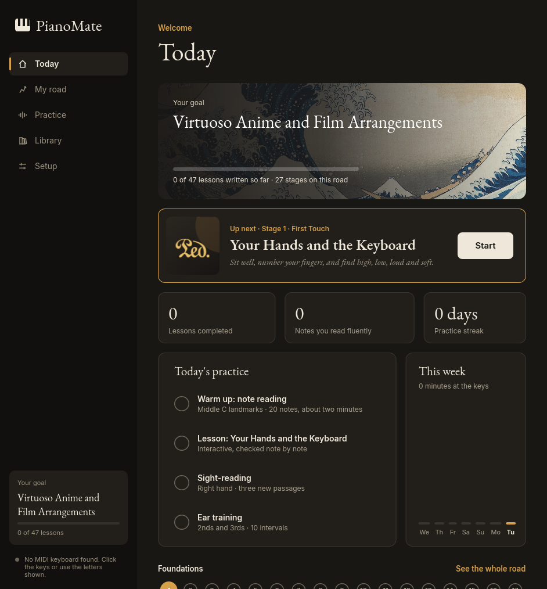
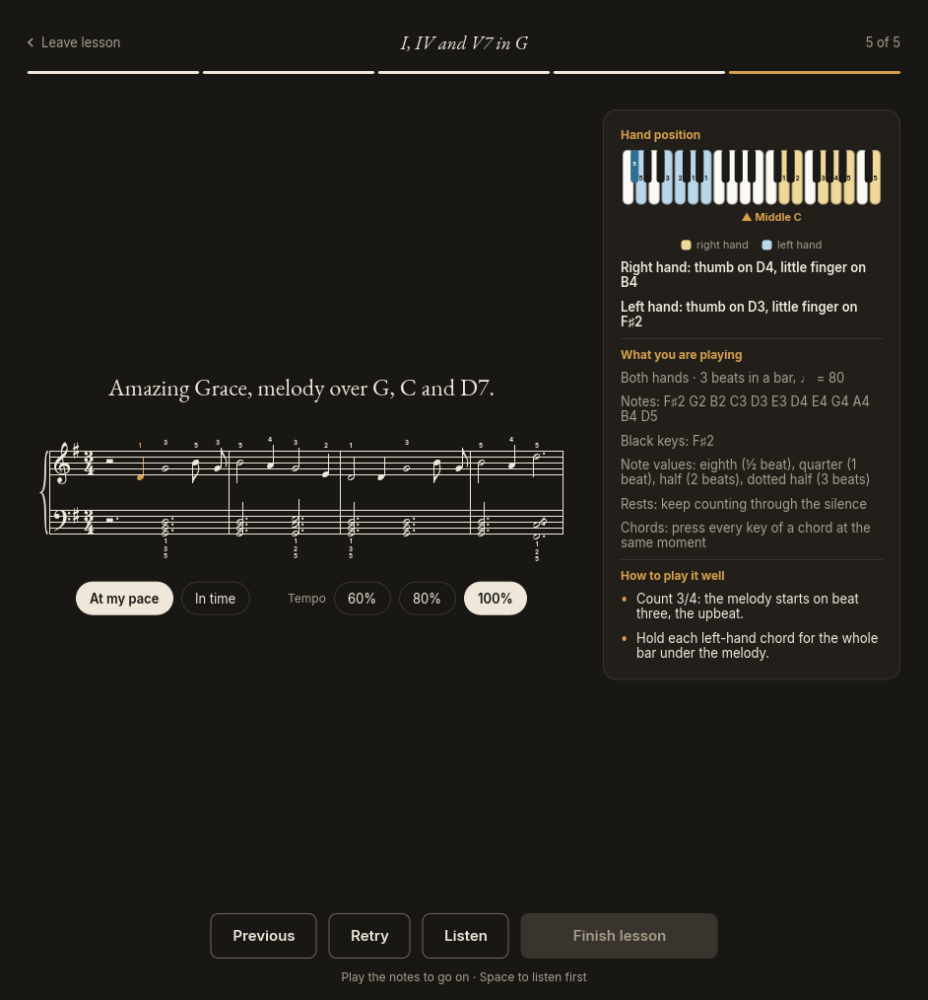
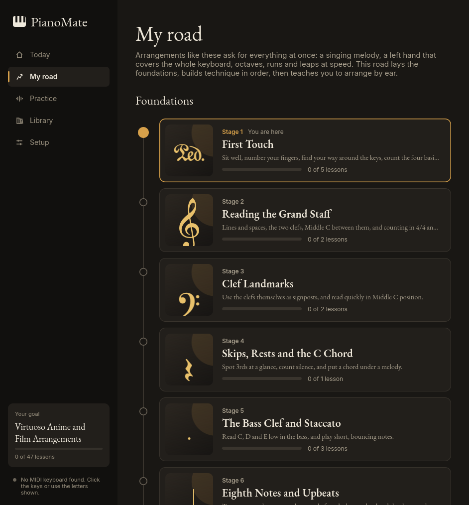
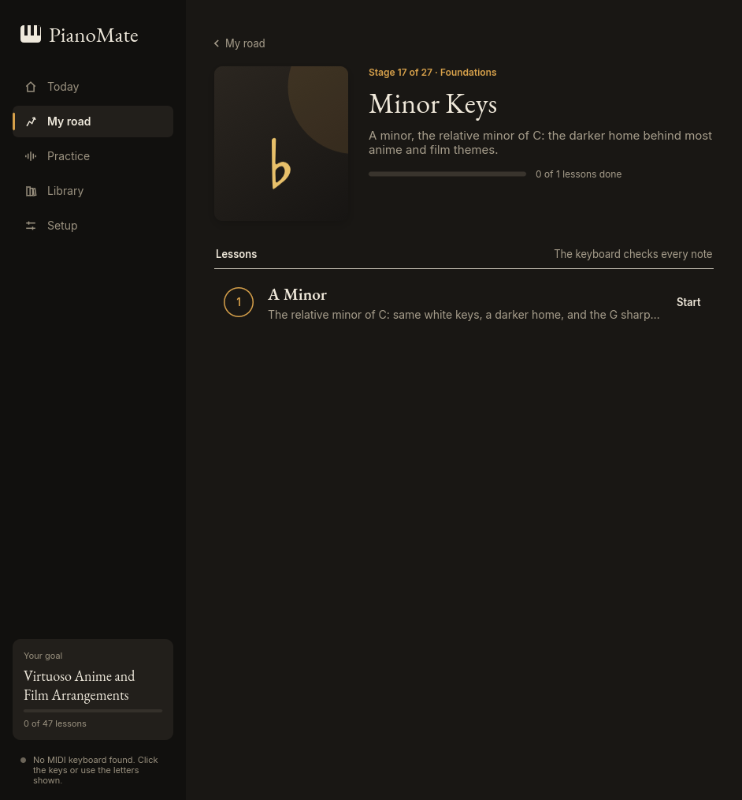
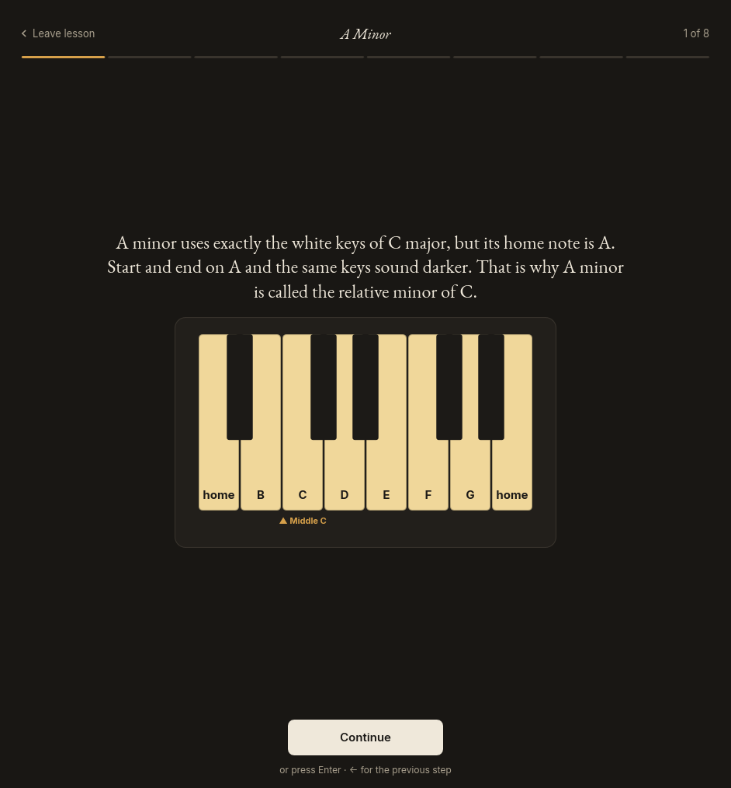
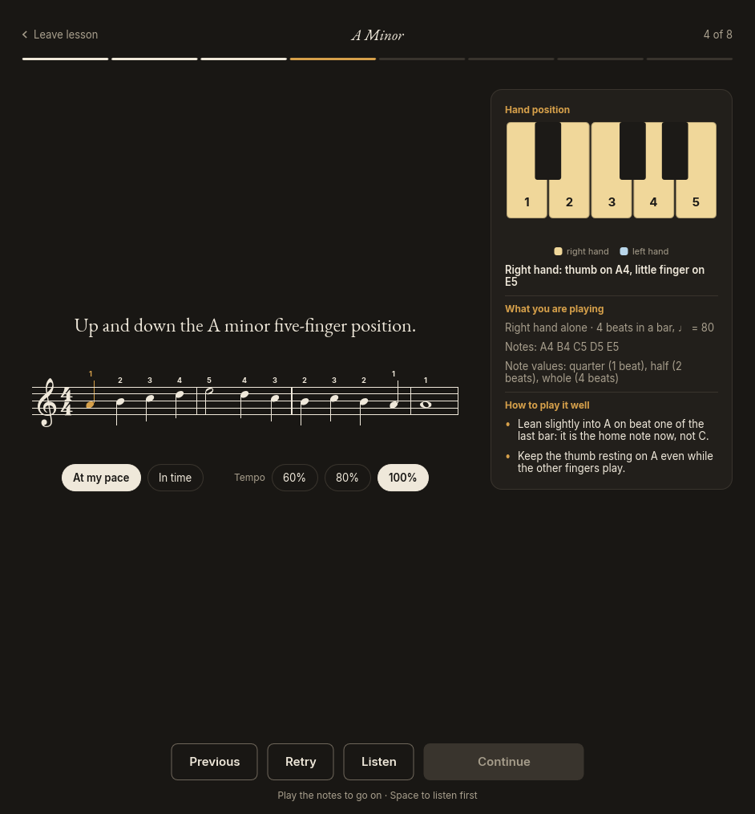
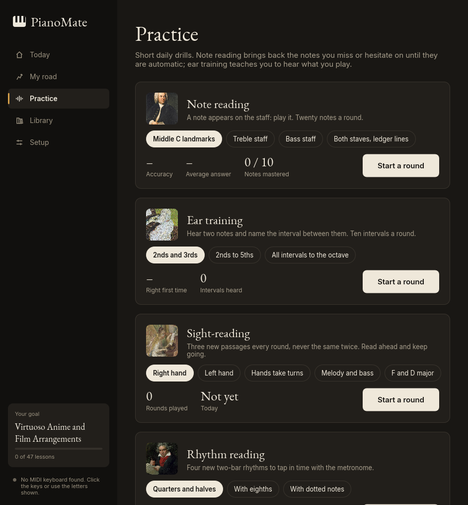
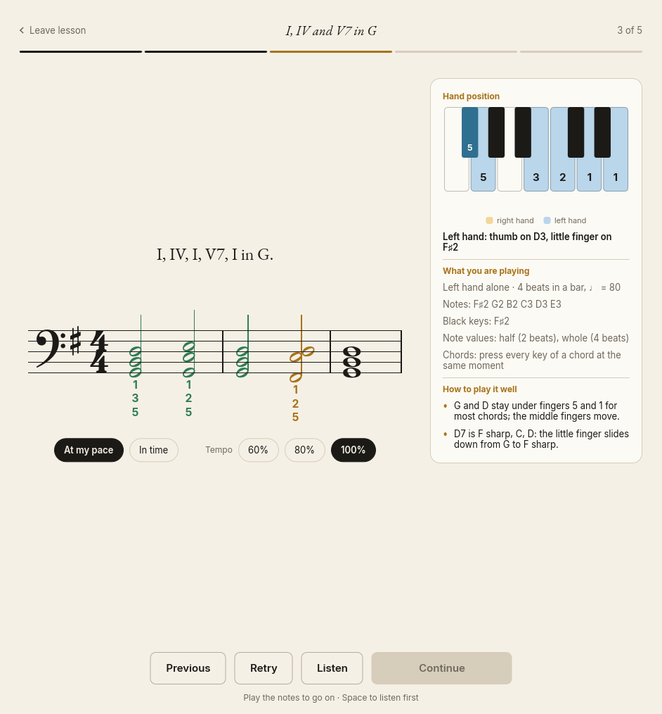

<h1 align="center">PianoMate</h1>

<p align="center">
  <b>A native desktop piano teacher, written in Rust.</b><br>
  From the first time you touch the keys to arranging by ear. Every note you play on a MIDI keyboard is checked for pitch, timing and length.
</p>

<p align="center">
  
  
</p>

---

## Contents

- [Features](#features)
- [Screenshots](#screenshots)
- [The road](#the-road)
- [Download](#download)
- [Getting started](#getting-started)
- [Controls](#controls)
- [Writing lessons](#writing-lessons)
- [Project layout](#project-layout)
- [Credits](#credits)
- [License](#license)

## Features

### Lessons you play, not read
- **Drawn figures.** Hand posture, numbered fingers, note values, dynamics and a live beat.
- **Keyboard diagrams.** Labelled keys, arcs for finger crossings and intervals, and a Middle C marker.
- **Step types.** Find-the-keys tasks, quizzes, rhythm taps against a metronome, and music for one or both hands on a grand staff with key signatures and finger numbers.
- **Hand-position panel.** It sits beside every passage and shows:
  - which keys each hand covers, with finger numbers
  - what the passage contains (notes, black keys, note values, rests, chords)
  - coaching tips for playing it well
- **Listen first.** Hear any passage before you play it.
- **Navigation.** Previous steps back through a lesson, Retry restarts an exercise, and Continue reopens the exact step you were on, even after you close the app.

### Real-time feedback
- **Note by note.** Each note is graded the moment you play it: right note, wrong note, wrong octave.
- **In-time mode.**
  - A count-in, then a moving playhead.
  - Each note is judged for timing, and half notes and longer must be held for their full length.
  - Play at 60%, 80% or 100% tempo.
- **Latency calibration.** Allows for the delay of your audio device, which matters most with Bluetooth headphones.

### Practice that never runs out
| Drill | What it does |
|---|---|
| Note reading | Adaptive: notes you miss or hesitate on come back more often |
| Ear training | Name the interval between two notes, from 2nds up to the octave |
| Sight-reading | New passages every round, in C, G, F and D positions, hands alone or together |
| Rhythm reading | Two-bar rhythms to tap in time, from quarter notes to dotted rhythms |
| Chord finding | A chord is named and you play it: major, minor, then inversions |
| Metronome | 40 to 200 bpm, in 2/4, 3/4, 4/4 or 6/4 |

### Progress
- **Mastery stars.**
  - ★ for finishing a lesson.
  - ★★ when every passage passes In time at 80% tempo.
  - ★★★ at full tempo.
- **Today page.** A daily plan, a practice streak, and your minutes at the keys this week.
- **Your own road.** The goal you pick at first launch decides which stages make up your road.

### Comfortable to use
- **Themes.** Light and dark, or follow the system.
- **Note names.** Letter names on the staff can be switched on for beginners.
- **On-screen piano.** Optional, and hidden by default.
- **MIDI hot-plug.** Turn your keyboard on at any time and it connects within two seconds.

## Screenshots

| | |
|---|---|
|  |  |
| **My road**: stages in order, each with its emblem and progress | **A stage**: its lessons, stars and what comes next |
|  |  |
| **Explaining with diagrams**: the relative minor on the keys | **Playing**: staff, finger numbers, hand panel, tempo chips |
|  |  |
| **Practice**: endless generated drills | **Library**: the public-domain classics the road draws on |

<p align="center">
  
  <br><em>Light theme</em>
</p>

## The road

27 stages and 47 lessons, in four parts:

| Part | Stages | You learn |
|---|---|---|
| **Foundations** | 17 | Posture, finger numbers, the grand staff, landmark notes, rhythm, Middle C, C and G positions, sharps and flats, intervals, the C and G scales, primary chords in C and G, A minor |
| **Technique** | 4 | Finger independence (Hanon), scales with thumb crossing, speed (Czerny), octaves and leaps |
| **Repertoire** | 3 | Hands together, first classics (Beethoven, Mozart, the Anna Magdalena Bach notebook), études |
| **Arranging** | 3 | Chord progressions, left-hand patterns (Alberti, waltz, broken chords), playing by ear |

At first launch you pick one of four goals, and each gets its own road:
- virtuoso anime and film arrangements
- classical repertoire
- songs and accompaniment
- reading for pleasure

## Download

Get the latest package for your system from [Releases](https://github.com/Agapenordev/PianoMate/releases/latest). A piano sound is included.

- **Windows**: unzip `PianoMate-…-windows-x86_64.zip` and run `pianomate.exe`. Windows SmartScreen may warn about an unsigned app: choose *More info → Run anyway*.
- **Linux**: `tar xzf PianoMate-…-linux-x86_64.tar.gz`, then run `./pianomate` from that folder. Needs ALSA, fontconfig and xkbcommon, which most desktops already have.

Keep the executable next to its `content` and `assets` folders. Plug in a MIDI keyboard at any time, or play with the computer keys.

To publish a new release, push a tag such as `v0.1.0`; GitHub Actions builds and uploads both packages.

## Getting started

To build from source instead:

**Requirements**
- Rust (stable)
- ALSA development headers on Linux
- A General MIDI SoundFont (`.sf2`)

```sh
# Linux build prerequisite
sudo zypper install alsa-devel        # openSUSE
sudo apt install libasound2-dev       # Debian / Ubuntu

# SoundFont (not in git). Any .sf2 works; development uses GeneralUser GS.
mkdir -p assets && cp /path/to/GeneralUser-GS.sf2 assets/piano.sf2

cargo run --release                   # or: cargo run -- path/to/other.sf2
cargo test                            # lesson engine, rhythm grading, drills, staff layout, content checks
```

[GeneralUser GS](https://github.com/mrbumpy409/GeneralUser-GS) is a good free choice of SoundFont.

Progress is saved to `~/.local/share/pianomate/progress.ron` on Linux, or the platform's user data directory elsewhere.

## Controls

| Input | Action |
|---|---|
| MIDI keyboard | Play (hot-plug: turn it on at any time) |
| `A S D F G H J K L ;` | White keys from Middle C |
| `W E T Y U O P` | Black keys |
| Mouse | Click the on-screen piano (enable it in Setup) |
| `Enter` | Continue |
| `←` | Previous step |
| `Ctrl+R` | Retry the current exercise |
| `Space` | Listen to the passage, or replay the interval |
| `1`–`9` | Answer a quiz |
| `Esc` | Leave a lesson or drill |

Run **Setup → Calibrate timing** once per audio setup so rhythm grading accounts for your device's delay.

## Writing lessons

Lessons are plain [RON](https://github.com/ron-rs/ron) files in `content/lessons/`, and stages are listed in `content/curriculum.ron`.
Music is written as text:

```ron
Play(
    prompt: "Left hand: Am, Dm, E, Am.",
    lh: "A2+C3+E3/4@5+3+1 | A2+D3+F3/4@5+2+1 | G#2+B2+E3/4@5+3+1 | A2+C3+E3/4@5+3+1",
    beats_per_bar: 4,
    hint: true,
    tips: ["A stays under finger 5 for Am and Dm; only the upper notes move."],
)
```

| Syntax | Meaning |
|---|---|
| `C4/2@1` | C4, two beats, finger 1 |
| `D4@2` | Same length as the previous note |
| `C4+E4+G4` | A chord |
| `r/2` | A two-beat rest |
| `\|` | Bar line |
| `key=1` / `key=-1` | Key signature: one sharp / one flat |

**Step types**

| Step | What it is |
|---|---|
| `Explain` | Text with a drawing: a keyboard diagram, a staff or a figure |
| `Quiz` | A question with choices |
| `Find` | Press the named keys |
| `Play` | Music for one or both hands |
| `PlayRhythm` | Tap a rhythm against the metronome |

`cargo test` checks every shipped lesson: that it parses, that every bar is full, and that every passage has tips. The formats are documented in `crates/pianomate-core/src/lesson.rs` and `curriculum.rs`.

## Project layout

```
crates/
  pianomate-core/      Pure logic, no I/O or UI, fully tested
    src/music.rs       Pitches, two-hand parts, fingering and hand positions
    src/lesson.rs      Lesson format and the step-by-step engine
    src/rhythm.rs      In-time grading and latency estimation
    src/drill.rs       Adaptive note reading and the generated drills
    src/notation.rs    Grand-staff layout as a display list
    src/curriculum.rs  Books, stages and goals
  pianomate/           The app
    src/main.rs        UI glue and app state
    src/audio.rs       SoundFont synth, metronome (cpal + rustysynth), MIDI (midir)
    ui/*.slint         Screens, widgets, figures and keyboard diagrams
content/
  curriculum.ron       Stages, goals and the library
  lessons/*.ron        The lessons
  images/              Public-domain paintings and portraits (see CREDITS.md)
docs/screenshots/      Images used in this README
```

**Built with:**
- [Slint](https://slint.dev) for the UI
- [cpal](https://github.com/RustAudio/cpal) for audio output
- [rustysynth](https://github.com/sinshu/rustysynth) for SoundFont synthesis
- [midir](https://github.com/Boddlnagg/midir) for MIDI input
- [rtrb](https://github.com/mgeier/rtrb) for lock-free UI-to-audio messaging
- [serde](https://serde.rs) and [RON](https://github.com/ron-rs/ron) for content and saves

## Credits

- **Fonts** (`crates/pianomate/ui/fonts`): [Bravura](https://github.com/steinbergmedia/bravura) for music symbols and [EB Garamond](https://github.com/octaviopardo/EBGaramond12), both under the SIL Open Font License.
- **Images**: public-domain paintings and portraits. Sources and licences are in [`content/images/CREDITS.md`](content/images/CREDITS.md).
- **Repertoire**: public-domain works by Hanon, Czerny, Bach and his circle, Beethoven, Mozart, Burgmüller, Clementi and Chopin. All lesson text, exercises and arrangements are original to PianoMate.

## License

PianoMate's code and lesson content are under the [MIT License](LICENSE).
The bundled fonts keep their SIL Open Font License, and the images are public domain.
